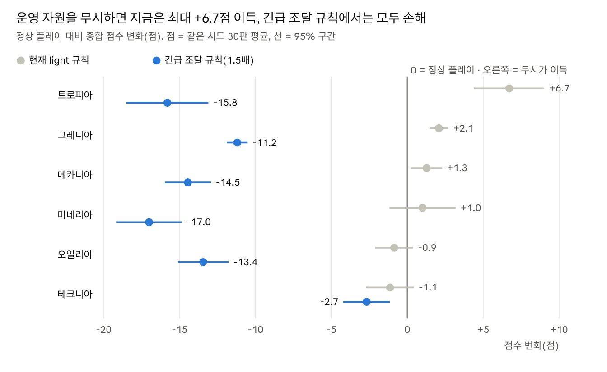

# 무역 게임 v17 교차 검증 보고서

Nov 19, 2026 · @박재욱

## 1. 전체 판정: 조건부 동의

light를 '다음 검증의 기준 후보'로 두는 판단에는 동의한다. 하지만 수업용 규칙으로 쓰기에는 아직 이르다. 공정하고 교육적인 완성안이라는 주장도 지금 자료로는 뒷받침되지 않는다.

**결정(11월 19일):** 결과는 나라별 목표 달성도로 보여 주고, 공동 목표는 두지 않는다. 공동 목표가 있으면 서로 희생하는 거래가 생겨 무역의 의미가 흐려질 수 있기 때문이다. 이에 따라 문제 2는 순위 조작이 아니라 ‘싸게 판 학생 자신의 손해’로 줄어들고, 목표의 공정성(문제 4)이 더 중요해졌다.

- **기존 수치는 모두 재현됐다.** 6,740게임 원본을 엔진 코드 없이 다시 계산했고, 보고서 표의 값이 모두 일치했다. 같은 조건의 게임 60판을 새로 돌려도 점수 차이는 0이었다.

- **학생이 운영 자원을 무시하면 오히려 이득이다.** 연료·광물을 사지 않는 나라를 만들어 보니 트로피아는 평균 +6.7점(30판 중 29판 이득)이었다. 그레니아는 +2.1점, 메카니아는 +1.3점이었다. 자동 국가(AI)는 무조건 사도록 짜여 있어서 기존 검증에서는 이 문제가 보이지 않았다.

- **'최저가 판매 0/360'은 혼자 할 때만 맞다.** 세 나라가 동시에 1G나 반값에 팔면 트로피아가 각각 24/30판, 29/30판에서 정상 플레이보다 점수가 높았다.

- **점수 100점 중 50점은 거의 모두 만점이다.** 국민 만족도와 무역 점수가 정상 국가 모두 24점 안팎이라, 순위는 사실상 투자로 정해진다. 미네리아는 자동 국가 수입만으로 경제 목표의 96%를 채운다.

가장 먼저 고칠 문제(운영 자원 무시가 이득인 구조)에는 '긴급 조달' 규칙을 1요인 실험으로 시험했다. 정상 플레이 점수는 그대로 두고, 무시 전략은 6개국 모두 손해로 바꿨다(4절).

## 2. 실제로 읽고 실행한 범위

새로 돌린 게임은 모두 570판이다. 원본 코드와 결과는 바꾸지 않았다. 복사본에서 실행했고, 검증 코드와 결과는 trade/claude_review/ 폴더에 두었다.

| 구분           | 내용                                                                                                                                                                                                                                                    | 게임 수 |
|----------------|---------------------------------------------------------------------------------------------------------------------------------------------------------------------------------------------------------------------------------------------------------|---------|
| 정적 코드 검토 | operating_engine.py, reference_engine.py, core_engine.py 전체. causal_engine·evaluation_engine·growth_scoring·budget_trace의 관련 함수. run_operating_validation.py의 attach_fixed_scores·run_one. 실행 중 게임 객체에서 활성 플래그를 직접 출력해 확인 | 0       |
| 독립 재계산    | 전체 증거 폴더의 validation_runs.jsonl.gz 6,740게임 전부. 엔진·점수·분석 코드를 import하지 않고 점수·현금 보존·운영 자원 수지·보고서 표를 다시 계산 (recompute_v17.py, stats_v17.py)                                                                    | 0       |
| 재현 실행      | light, 두 제조 조건 × 시드 132000~132029                                                                                                                                                                                                                | 60      |
| 운영 자원 무시 | 한 나라만 연료·광물 구매·보호를 하지 않음. 6개국 × 30시드                                                                                                                                                                                               | 180     |
| 3국 동시 행동  | 학생이 맡는다고 가정한 트로피아·오일리아·테크니아가 동시에 무행동 / 1G 판매 / 운영 무시 / 반값 판매                                                                                                                                                     | 120     |
| 수정안 시험    | 긴급 조달 규칙. 전체 정상 30 + 운영 무시 6개국×30                                                                                                                                                                                                       | 210     |

모든 새 게임은 baseline 제조, light 운영, 시드 132000~132029이다. 같은 시드의 저장된 정상 게임과 짝지어 비교했다. 수정안 첫 실행에서는 내가 쓴 코드가 기존 현금 원장 검사와 맞지 않아 178판이 멈췄다. 긴급 조달비를 국가 수입 차감으로 기록하도록 고친 뒤 210판을 전부 다시 돌렸고, 모두 완주했다.

**하지 않은 것:** 기존 감사기(audit_operating_validation.py) 재실행, 6,776판 전체 재실행, daily 행동 검사, electronics_input 조건의 새 실험, calibration_v15 목표 재산출, machinery·raw·routing·development 엔진 내부의 세부 로직 검토, 실제 학생 플레이.

## 3. 문제 목록

수업에 바로 영향을 주는 문제는 두 가지다. 학생이 운영 자원을 무시해도 되는 구조(1번), 그리고 학생끼리 싸게 팔아 순위를 바꿀 수 있는 구조(2번)다. 표의 수치는 baseline·light 기준이고, 괄호는 95% 구간(시드 차이 기준)이다.

| \#  | 심각도 | 문제                                                 | 재현 조건과 결과                                                                                                                                                                          | 위치                                                            | 경제·학습 영향                                                                                                                                                             |
|-----|--------|------------------------------------------------------|-------------------------------------------------------------------------------------------------------------------------------------------------------------------------------------------|-----------------------------------------------------------------|----------------------------------------------------------------------------------------------------------------------------------------------------------------------------|
| 1   | 높음   | 운영 자원을 사지 않는 편이 점수에 유리하다           | 한 나라만 운영 자원을 무시(30시드). 트로피아 +6.72점 \[4.41, 9.03\], 29/30판 이득. 그레니아 +2.08 (26/30), 메카니아 +1.27 (21/30), 미네리아 +1.00 (11/30). 오일리아 −0.86, 테크니아 −1.14 | operating_engine.py settle_round의 감점(연료 8, 광물 4)         | 부족 1회의 손해는 만족도 점수 약 −0.22점과 수입 −1G다. 반면 연료 1묶음(약 30G)을 사면 트로피아는 경제 성장 점수 약 −2점이다. 학생에게 '자원을 수입할 이유'가 생기지 않는다 |
| 2   | 높음   | 여러 학생이 동시에 싸게 팔면 특정 나라가 이득을 본다 | 트로피아·오일리아·테크니아가 동시에 1G 판매: 트로피아 +4.77 \[1.97, 7.57\], 24/30판 이득. 동시에 반값 판매: 트로피아 +9.00 (29/30), 오일리아 +1.44 (19/30), AI 3국 평균 +3.64             | 판매가 하한 1G(price_tick=1), 점수에 교역 조건이 없음           | 기존 0/360은 혼자 할 때의 결과다. 학생끼리 밀어주기로 순위가 바뀐다. 하한가를 반값으로 올려도 해결되지 않는다                                                              |
| 3   | 중간   | 만족도·무역 점수가 차이를 구별하지 못한다            | 정상 600국가·게임: 만족도 평균 23.81/25(최저 22.43), 무역 24.03/25(최저 19.84). '무역 중심' 행동의 무역 점수 차이 −0.01. 총점 차이 −11.7점은 거의 생산 능력(−11.3)에서 온다               | core_engine.py summary의 무역 점수                              | 무역 단원 게임인데 무역을 잘하는 것이 점수에 드러나지 않는다. 순위는 투자가 정한다                                                                                         |
| 4   | 중간   | 경제 성장 점수가 자동 수입에 좌우된다                | 9라운드 국가 수입 약 177G. 목표 대비 미네리아 0.96, 메카니아 0.77, 오일리아 0.73, 그레니아 0.67, 트로피아 0.58, 테크니아 0.20. 무행동 미네리아의 경제 성장 20/20                          | growth_scoring.py 자산 증가 = 현금+재고+투자 45%                | 무행동 학생의 경제 성장 점수는 평균 1.5점만 줄어든다. 나라마다 목표 난도가 크게 다르다                                                                                     |
| 5   | 중간   | 자원국 우위가 규칙이 만든 수요에서 나온다            | none→light: 미네리아 활용률 점수 2.55→6.32, 자산 증가 166→223G. 오일리아 활용률 5.76→7.94, 자산 증가 224→277G. 트로피아 −9.1점, 그레니아 −4.4점. 그레니아 1위 0/100                       | growth_scoring.py extract_metrics의 활용률(국가 운영 소비 포함) | 다른 나라의 운영 소비가 자원국의 '산업 활용' 점수로 바로 들어간다. 새 투자의 성과와는 무관하다                                                                             |
| 6   | 낮음   | 자급하는 나라는 수입 점수가 0점이다                  | import_score = 8\*filled/ext if ext else 0. 외부 필요가 없으면 수입 8점과 효과 4점을 못 받는다                                                                                            | core_engine.py summary                                          | 현재 정상 플레이에서는 모두 필요가 있어 영향이 작다. 필요를 일부러 만드는 쪽이 유리해질 수 있다                                                                            |
| 7   | 낮음   | 투자 뒤 다음 운영비를 남기지 않는다                  | 투자 중심 행동 47/360에서 운영 부족(기존 보고와 같음)                                                                                                                                     | core_engine.py run(정산 뒤 투자), reserve                       | 1번 수정안이 함께 해결한다                                                                                                                                                 |

코드가 오류 없이 도는 것은 확인했다. 현금 보존·재고 보존·운영 자원 수지에서 어긋난 게임은 없었다. 위 문제는 모두 '수업 의도대로 작동하는가'의 문제다.

## 4. 해결 방안과 시험 결과

1번 문제에는 '긴급 조달' 규칙을 권한다. 정상 플레이는 바꾸지 않고, 운영 자원을 무시하는 전략만 손해로 만든다.

**긴급 조달 규칙(시험함).** 정산일에 운영 자원이 없으면 기준가의 1.5배(연료 45G, 광물 30G)를 국가 수입에서 자동으로 뺀다. 돈을 다 냈으면 만족도 감점은 없다. 돈이 모자랄 때만 기존 감점을 준다. 학생에게는 "미리 사 두지 않으면 비싸게 긴급 구매한다"로 설명할 수 있다. 물건을 새로 만들어 주지 않으므로 재고·가격 규칙은 그대로다.

Claude 새 시뮬레이션 · baseline 제조, light 운영 · 시드 132000~132029 · 나라별 30판(현재 180판, 수정안 180판)을 저장된 정상 게임과 짝 비교

- 모든 나라가 정상 플레이하면 점수 변화는 6개국 모두 0.00이었다(30판). 정상 플레이에서는 부족이 한 번도 없어 규칙이 발동하지 않았다.

- 무시한 나라가 낸 긴급 조달비는 평균 약 195G(테크니아는 74G)였다. 테크니아만 3/30판에서 여전히 이득이었다.

- 더 약한 값(1.0배·1.2배)과의 비교는 9절에 있다. 기초 가격 그대로도 충분했다.

**나머지 문제의 방안(아직 시험하지 않음).** 한 번에 하나씩 바꿔서 시험해야 한다.

| 문제                | 방안                                                                                                                                                                            | 시험 방법                         |
|---------------------|---------------------------------------------------------------------------------------------------------------------------------------------------------------------------------|-----------------------------------|
| 2\. 동시 저가 판매  | 국가끼리 순위를 매기기보다 국가별 목표 달성도(등급)로 결과를 보여 준다. 기준가 절반 미만 판매는 '원조'로 표시하고 무역 점수에서 뺀다. 교사용 화면에 판매가/기준가 비율을 띄운다 | 3국 동시 1G·반값 스트레스 재실행  |
| 3\. 점수 변별력     | 무역 점수를 '내 물건이 다른 나라에서 실제 쓰인 양'과 '필요 충족률' 중심으로 바꾼다. 거래 여부만으로 거의 만점이 나오지 않게 한다                                                | 기존 6,740 기록 재채점(새 게임 0) |
| 4\. 자동 수입       | 경제 성장 계산에서 기본 수입분을 뺀다. 코드에 이미 growth_ex_base_income 진단값이 있다                                                                                          | 기존 기록 재채점                  |
| 5\. 자원국 우위     | 산업 활용 10점에서 국가 운영 소비를 빼고, 무역 점수(수출한 물건이 실제 쓰임)에만 반영한다                                                                                       | 기존 기록 재채점                  |
| 6\. 자급국 수입 0점 | 외부 필요가 없으면 수입 항목을 만점으로 보거나 분모에서 뺀다                                                                                                                    | 기존 기록 재채점                  |

## 5. 기존 주장과 독립 재계산 비교

저장된 결과에 대한 수치 주장은 모두 일치했다. 다른 것은 수치가 아니라 그 수치를 어디까지 넓혀 해석하느냐다(마지막 두 행).

| 기존 주장                                                                                   | Claude 계산                                                                                                                                                                | 차이           | 근거                              |
|---------------------------------------------------------------------------------------------|----------------------------------------------------------------------------------------------------------------------------------------------------------------------------|----------------|-----------------------------------|
| 정식 6,740게임, 현금·재고 불변식 통과                                                       | 6,740게임 모두 ‘현금 합 = 시작 현금 + 국가 수입 − 투자’ 성립. 음수 현금 0, 운영 자원 필요 = 소비 + 부족 성립                                                               | 없음           | recompute_v17.py                  |
| 비교 점수는 fixed_evaluation.score                                                          | 구성 요소에서 직접 다시 더해 40,440 국가·게임 전부 일치(오차 10⁻⁶ 이하). 기존 score와 별개 필드다. 다만 30%(12,331건)는 두 값이 우연히 같아, 필드를 섞어도 눈에 잘 안 띈다 | 없음           | recompute_v17.py                  |
| 투자자산 45%, economic_old·industrial_steps 사용. 메타데이터 1.0은 미적용                   | end_asset_value에 0.45×투자가 들어 있고, 목표는 economic_old(305…895)·industrial_steps로 점수가 재현됨                                                                     | 없음           | growth_scoring.py extract_metrics |
| 7.2표(baseline light: 광물 13.66, 연료 23.49, 운영 18/27, 부족 0, 만족도 95.25, 격차 12.90) | 8개 행 모두 같은 값                                                                                                                                                        | 없음           | stats_v17_output.txt              |
| 연료 거래 8.93→26.44, 광물 19.34→29.90                                                      | 같음                                                                                                                                                                       | 없음           | 같은 파일                         |
| 7.3표 국가별 현금·투자·점수                                                                 | 두 제조 조건 모두 같음                                                                                                                                                     | 없음           | 같은 파일                         |
| 게임별 격차 변화 −0.678 \[−2.203, +0.848\], electronics_input +5.401 \[+4.145, +6.657\]     | 같음. 자원국 1위 93/100(오일리아 54, 미네리아 39)도 같음                                                                                                                   | 없음           | 같은 파일                         |
| 최저가·무행동 0/360, 반값 19·18·14/60                                                       | 같음(분모 360 = 6국×2제조×30시드)                                                                                                                                          | 없음           | 같은 파일                         |
| 무행동 운영 부족 240/360, 3.333라운드, 만족도 −33.904. 투자 중심 47/360                     | 같음                                                                                                                                                                       | 없음           | 같은 파일                         |
| 무역 중단 시 만족도 95.236→63.833, 식량 부족 4.667라운드, 운영 부족 0→30                    | 같음. 6국 평균 점수는 87.44→40.43                                                                                                                                          | 없음           | 같은 파일                         |
| (재현성)                                                                                    | 같은 조건 60판을 새로 돌린 점수와 저장값의 최대 차이 2.8×10⁻¹⁴                                                                                                             | 없음           | new_sims.py repro                 |
| light는 자원의 실제 소비와 무역 수요를 늘렸다                                               | AI가 무조건 사기 때문에 생긴 결과다. 학생이 무시하면 트로피아·그레니아·메카니아는 이득이다                                                                                 | 해석 범위 축소 | 3절 문제 1                        |
| 최저가·저가 행동은 이득이 없다                                                              | 한 나라만 할 때는 맞다. 세 나라가 동시에 하면 트로피아가 24/30(1G)·29/30(반값)판 이득이다                                                                                  | 해석 범위 축소 | 3절 문제 2                        |

## 6. 기획과 현재 구현의 차이

실행 중인 게임에서 설정을 직접 출력해 확인했다: planning=True, negotiations=True, price_v2=True, smaller_bonus=True, price_tick=1, storage_fees=False, bonus_inputs=False, stock_discipline=False, 조언 listing_budget=False, planning=False, raw_variant bridge. 인수인계 문서의 설명과 같다. 꺼진 기능이 보류인지 누락인지는 인수인계 문서의 설명을 따랐다. history/v13 원문은 직접 읽지 않았다.

| 사용자 요구                         | 현재 구현                                                                                                                      | 상태                   | 영향                                          |
|-------------------------------------|--------------------------------------------------------------------------------------------------------------------------------|------------------------|-----------------------------------------------|
| 자원을 국가 운영 기본 품목으로 사용 | light 후보. 엔진 기본값은 none                                                                                                 | 후보                   | 학생이 무시해도 손해가 없다(문제 1)           |
| 수요·공급에 따른 기준 가격          | 활성                                                                                                                           | 구현                   | 없음                                          |
| 자유 판매가                         | 1G 이상 정수                                                                                                                   | 구현                   | 동시 저가 판매 문제(문제 2)                   |
| 역제안 협상                         | 기준가 95%에서 신뢰도로 최대 5%p 할인한 한 번의 역제안. 80% 희망가 변수는 계산만 하고 쓰지 않음(reference_engine.py negotiate) | 일부 구현              | 주고받는 협상은 아직 없다                     |
| 무역 신뢰도                         | 직접·물물교환 성공 시 국가 쌍당 라운드 1회 +10, 최대 100. 할인에만 쓰임                                                        | 일부 구현              | 학생이 체감할 효과가 작다                     |
| 산업 발전 = 능력 + 실제 활용        | 15점 + 10점. 활용에 다른 나라의 운영 소비도 들어감                                                                             | 구현                   | 자원국 활용 점수가 규칙 때문에 오른다(문제 5) |
| 보관비·생산비                       | 보관비 비활성, 일반 생산비·판매 수수료 없음                                                                                    | v13 비용 실험에서 보류 | 재고를 쌓아도 비용이 없다                     |
| 판매 수량 추천                      | listing_budget 비활성. 필요량 보호·잉여 등록은 작동                                                                            | 보류                   | 학생용 화면 설계 때 재검토                    |
| 식품 부패                           | 없음                                                                                                                           | 미확인                 | 식량을 무한히 쌓을 수 있다                    |
| 학생 3명 + AI                       | 9국 모두 AI인 시뮬레이션. 이번에 3국 동시 행동으로 일부 대신 시험                                                              | 미구현                 | 학생 행동은 AI 정책보다 폭이 넓다             |
| 무관심 학생 대비                    | 무행동은 34–43점으로 항상 꼴지(360/360). 다만 경제 성장·현금 여력 점수는 거의 그대로                                           | 구현                   | 순위는 맞지만 점수 의미가 약하다(문제 4)      |
| 개별 접속 웹앱·저장·보고서          | 없음(Python 순차 시뮬레이터)                                                                                                   | 미구현                 | 동시 접속·인증은 미검증                       |

## 7. 유지할 것, 고쳐 쓸 것, 아직 모르는 것

**유지**

- 현금·재고·운영 자원 수지와 점수 계산은 정확하다.

- 세 운영안 중 light가 격차와 부족이 가장 작다. regular는 게임별 격차 +5.8점, daily는 +20.7점이다.

- electronics_input과 light를 함께 쓰지 않는다는 판단. 자원국이 93/100판에서 1위다.

- 무역을 막으면 모든 나라의 생활이 무너진다는 결과. 상호 의존을 보여 주는 장치로 쓸 수 있다.

**고쳐 쓸 것**

- "light가 자원의 실제 소비와 무역 수요를 늘렸다" → "AI가 항상 살 때는 늘렸다. 학생은 무시하는 편이 유리할 수 있다."

- "최저가·무행동은 이득이 없다(0/360)" → "한 나라만 고정 행동을 할 때는 이득이 없다. 여러 나라가 동시에 싸게 팔면 다르다."

**아직 모르는 것**

- 긴급 조달 배수를 1.5가 아닌 다른 값으로 했을 때의 결과, 그리고 electronics_input 조건에서의 결과.

- daily 운영안의 행동 스트레스 결과.

- 새 경제에서 나라별 성장 목표의 난도. 목표는 v12 보정 기록에서 나왔고, 미네리아는 자동 수입만으로 거의 도달한다.

- 학생 3명이 80분 안에 규칙을 이해하고 끝까지 플레이할 수 있는지. 일정이 다른 두 자원(연료 R3·6·9, 광물 R4·8)을 초등학생이 기억할 수 있는지도 포함한다.

- 목표 달성도의 등급 기준(예: 몇 %부터 A등급인지)과, 나라별 목표를 새 경제에 맞게 다시 정하는 방법.

## 8. 먼저 해결할 3가지와 후속 실험

아래 순서대로 하나씩 진행한다. 각 실험에서 바꾸는 것은 한 가지뿐이고, 성공 기준은 실행 전에 정한다. 보존하는 조건은 모두 같다: 시작 현금·생산·투자 비용·가격 규칙·v15 목표·fixed_evaluation 점수.

| 순서 | 무엇을 해결                      | 바꾸는 요인                                                                              | 표본                                                                                      | 성공 기준(사전 지정)                                                                                                                                                                           |
|------|----------------------------------|------------------------------------------------------------------------------------------|-------------------------------------------------------------------------------------------|------------------------------------------------------------------------------------------------------------------------------------------------------------------------------------------------|
| 1    | 운영 자원을 살 이유              | 부족 처리만: 현재 감점 / 긴급 조달 1.2배 / 1.5배                                         | baseline·light. 정상 시드 130000~130099(100판×3), 운영 무시·무행동 6국×시드 132000~132029 | ① 운영 무시는 6국 모두 평균 점수 하락, 이득 판수 5/30 이하 ② 정상 플레이 점수 변화 0.5점 미만 ③ 무행동 학생 점수가 현재보다 얼마나 낮아지는지 함께 보고. ①②을 만족하는 가장 약한 배수를 후보로 |
| 2    | 학생 여러 명의 동시 행동         | 새 규칙 없음. 스트레스 묶음만 추가: 학생이 맡을 3국 조합 × {1G, 반값, 무행동, 운영 무시} | 6국에서 3국을 고르는 20조합 × 4행동 × 30시드 = 2,400판                                    | 어느 조합에서도 한 나라가 정상보다 이득인 판이 5/30을 넘지 않는지 확인. 목표 달성도 기준으로도, 싸게 판 학생의 손해가 학생이 눈치챌 수 있을 만큼 분명한지 확인                                 |
| 3    | 점수가 무역과 노력을 보여 주는가 | 채점식 한 가지씩: (a) 경제 성장에서 기본 수입 제외 (b) 활용률에서 국가 운영 소비 제외    | 기존 6,740판 재채점(새 게임 0)                                                            | 무행동과 정상의 경제 성장 점수 차이가 커지는가, 미네리아·오일리아의 none→light 점수 상승이 얼마나 줄어드는가, 나라별 평균 점수 격차                                                            |

실험 1은 이번에 쓴 claude_review/new_sims.py의 Emergency 클래스에 배수만 매개변수로 빼면 바로 돌릴 수 있다. 한 판에 약 0.35초이라 2코어에서 2,400판도 10분 안팎이다.

교육적 확인은 시뮬레이션으로 대신할 수 없다. 첫 시범 수업에서는 학생이 '우리 나라가 무엇을 수입했고 왜 필요했는지'를 한 줄로 쓰게 해 보면, 수입 필요성이 실제로 전달됐는지 확인할 수 있다.

## 9. 실험 1 결과: 긴급 조달 비용 비교

기초 가격 그대로(연료 30G, 광물 20G)만 받아도 충분하다. 이 값에서도 운영 자원을 무시하면 6개국 모두 손해였고, 정상 플레이는 전혀 변하지 않았다. 정상 100판에서 연료 기준가는 한 번도 30G, 광물은 20G를 넘지 않았고(예시 한 판의 실제 연료 거래가는 14~20G), 미리 사는 쪽이 항상 싸기 때문이다.

표의 값은 운영 자원을 무시한 나라의 점수 변화(점)이고, 괄호는 정상보다 점수가 높았던 판 수(30판 중)다. baseline·light, 시드 132000~132029.

| 부족 시 처리        | 연료/광물 비용 | 트로피아  | 그레니아  | 오일리아  | 메카니아  | 미네리아  | 테크니아 | 기준 충족 |
|---------------------|----------------|-----------|-----------|-----------|-----------|-----------|----------|-----------|
| 현재(만족도 감점만) | 없음           | +6.7 (29) | +2.1 (26) | −0.9 (9)  | +1.3 (21) | +1.0 (11) | −1.1 (7) | 아니오    |
| 기초 가격 1.0배     | 30G / 20G      | −10.0 (1) | −5.9 (0)  | −7.5 (0)  | −6.8 (1)  | −8.5 (1)  | −2.0 (4) | 예        |
| 1.2배               | 36G / 24G      | −13.0 (0) | −7.8 (0)  | −9.5 (0)  | −9.6 (0)  | −11.9 (1) | −2.2 (3) | 예        |
| 1.5배               | 45G / 30G      | −15.8 (0) | −11.2 (0) | −13.5 (0) | −14.5 (0) | −17.0 (0) | −2.7 (3) | 예        |

- **정상 플레이:** 1.2배·1.5배 각각 100판(시드 130000~130099)에서 긴급 조달이 한 번도 일어나지 않았다. 점수 차이는 모든 나라에서 0이다.

- **무행동 학생:** 1.2배에서 트로피아 41.0→32.0, 그레니아 42.7→32.2, 메카니아 39.4→27.2, 테크니아 35.1→32.6점으로 내려간다. 오일리아·미네리아는 자기 연료·광물이 있어 아무것도 안 해도 비용을 내지 않는다(41.1, 37.8점 그대로). 1.0배의 무행동 점수는 돌리지 않았다.

- **테크니아:** 어느 값에서도 손해가 2점 안팎으로 작다. 경제 목표(895G)가 커서 현금 몇십 G의 비중이 작기 때문이다. 목표를 다시 정하면 이 수치도 바뀜다.

- **사전 기준과 다른 점:** 실험 설계에는 1.0배가 없었다. 1.2배 결과를 보고 더 약한 값을 하나 더 돌렸다. 거래 가격이 기초 가격보다 높아지는 경제(예: electronics_input)에서는 1.0배가 부족할 수 있어 다시 확인해야 한다.

새로 돌린 게임은 1.2배 460판, 1.5배 460판, 1.0배 180판, 가격 확인 100판으로 모두 1,200판이다. 실패는 없었다. 1.5배 재실행 점수는 앞서 돌린 수정안 실험과 완전히 같았다. 결과는 claude_review/new_games/mult_comparison.json에 있다.
